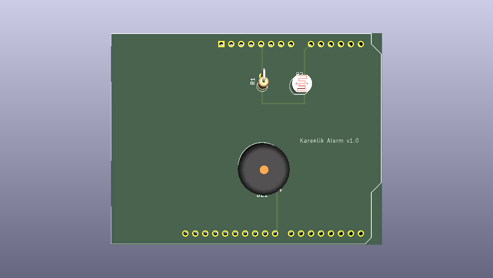

# Dark Alarm Shield v1.0

A 2-layer Arduino UNO shield that sounds a buzzer when the ambient light drops below a threshold.
Designed end-to-end in **KiCad 10**: schematic → ERC → footprints → PCB layout → DRC → Gerber/drill output.



## Overview

| | |
|---|---|
| Form factor | Arduino UNO shield, 69 × 54 mm |
| Layers | 2 (signals on F.Cu, GND copper pour on B.Cu) |
| Sensor | LDR in a voltage divider with a 10 kΩ resistor → analog input |
| Output | Buzzer on digital pin D8 |
| Components | All through-hole (R1 10 kΩ, R2 LDR, BZ1 buzzer) |
| Design rules | 0.25 mm minimum track width / clearance; signal tracks 0.4 mm |
| Tool | KiCad 10 |


## Repository structure

```
hardware/   KiCad project (.kicad_pro, .kicad_sch, .kicad_pcb)
fab/        Gerber files, PTH/NPTH Excellon drill files, .gbrjob (zipped)
docs/       Schematic PDF, 3D renders, BOM
firmware/   Arduino sketch
```

## Design decisions

- **Shield form factor:** the board plugs directly onto an Arduino UNO, so no extra wiring is needed.
- **GND pour on the bottom layer:** all signal routing stays on the top layer and the bottom layer is a continuous ground plane. This gives a low-impedance return path and makes routing simpler.
- **0.4 mm signal tracks:** wider than the 0.25 mm minimum, for easier manufacturing and more robust traces at no cost on a board this size.
- **Footprints chosen to match real parts:**
  - R1: `R_Axial_DIN0207_L6.3mm_D2.5mm_P2.54mm_Vertical`
  - R2 (LDR): `R_LDR_4.9x4.2mm_P2.54mm_Vertical`
  - BZ1: `Buzzer_12x9.5RM7.6`

## Problems I solved

| Problem | What I did |
|---|---|
| ERC errors on unconnected pins and power nets | Added no-connect flags and `PWR_FLAG` symbols → 0 ERC violations |
| DRC clearance violation near the A0 trace | Re-routed the trace |
| Some tracks were 0.2 mm (below my design rule) | Widened them to 0.4 mm |
| Duplicate rectangle on Edge.Cuts | Removed the extra outline so the board has a single closed edge |
| Courtyard warnings caused by the shield headers | Checked them one by one and excluded the false positives |
| Silkscreen clipped by pads | Reviewed the warnings and left the harmless ones on purpose |

## Manufacturing outputs

- 7 Gerber layers + PTH and NPTH Excellon drill files + `.gbrjob`
- Checked in KiCad GerbView before zipping
- Silkscreen includes the board name/version and the buzzer polarity (+) mark

## Firmware

`firmware/dark_alarm.ino` reads the LDR voltage on the analog input and turns the buzzer on when the reading crosses a threshold.

## What I learned

- The full PCB flow in KiCad, from schematic capture to fabrication files
- How design rules and net classes are set up, and how to read and fix ERC/DRC reports
- What a PCB manufacturer expects (Gerber layers, drill files, board outline)


## License

Hardware: [CERN-OHL-S-2.0](https://ohwr.org/cern_ohl_s_v2.txt) · Firmware: MIT
